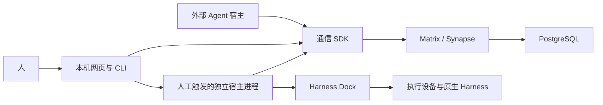
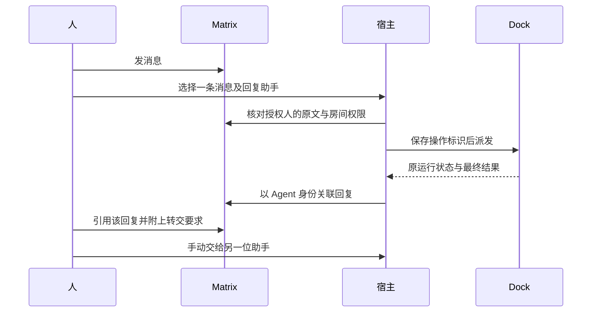

# 职责与数据归属

| 事实 | 拥有者 | 当前存储 |
| --- | --- | --- |
| 身份、房间、成员、消息、引用与历史 | Matrix / Synapse | Synapse 的 PostgreSQL |
| 谁能操作应用里的 Agent | 接入应用 | 接入方原有认证与授权 |
| 本机受管身份对应的会话、显示名与执行方式 | 本机宿主 | `.local/agents.json` 及其私有引用文件 |
| 原请求、运行 ID、Dock 回执与待发送回复 | 独立宿主 | `.local/agent-host/`；启动 / 活动信息在 `.local/host-worker/` |
| 执行进程、运行状态和模型结果 | Harness Dock / 原生 Harness | 执行设备 |
| 草稿、选择项、未确认发送的事务 ID | 网页当前浏览器会话 | sessionStorage，不含认证凭据 |

本机助手列表是宿主接入配置，不是另一份成员账本。每次读取 / 发送检查人的加入状态，执行另查目标助手的加入状态。其他应用可直接使用 SDK，不需要本机网页或 Dock。

## 人工转交

宿主只接受授权人的指令；Agent 消息和 @ 不自动启动执行。转交的引用内容是待处理材料，不是新的授权来源。真实工具权限由 Harness 决定。

## 失败与恢复

- 发送未确认：保留原文本、目标与事务 ID，沿原事务核对。
- 请求派发前：保存稳定操作 / 运行标识，SDK 保存私有回执。
- 浏览器断连：后端继续观察原任务。
- 网页后端重启：独立宿主继续持有 Dock 应用连接和交付过程，网页重新投影原记录。
- 独立宿主 / Dock 应用连接也中断：原任务可能失败或未知，按原回执核对，不能保证继续执行。
- 没有 Dock 回执：保持待核对，不生成替代运行。
- 最终结果已取得、回复未确认：先保留 outbox，再沿固定 Matrix 事务发送。

这不是业务事务恰好一次承诺，也不是分布式任务调度平台。当前示例按 Agent / 房间 / 消息定位原运行，单个宿主连接串行观察；接入方可按自己的业务边界替换执行宿主。

网页启动宿主时使用独立进程、私有文件日志与执行锁。活动文件只有在对应执行锁有效时才被使用，不用保存的 PID 判断存活或杀进程。单条操作 / Dock 连接锁继续由原宿主函数维护；不同 Agent 的回执定位不变。
