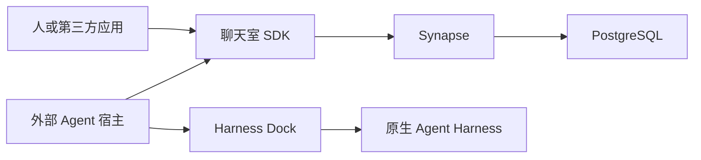

# 如何使用与接入

matrix-team-chat 是嵌入产品的通信 SDK，当前附带本地 CLI 和一个真实 Agent 宿主示例。

已有本机配置可运行 `pnpm web`，直接在[网页演示](web-demo.md)中发送消息、选择原文并查看助手回复。它复用下述 SDK 和宿主，凭据由本机服务端持有。

## 职责与数据归属



| 部分 | 负责什么 | 数据放哪里 |
| --- | --- | --- |
| 聊天 SDK | 房间、成员、收发消息、回复、历史和同步 | 通信事实保存在 Synapse 的 PostgreSQL 中 |
| CLI | 用本地身份调用同一套 SDK 函数 | 会话、房间引用及同步游标在 `.local/`，不另建消息库 |
| Agent 宿主 | 决定接受谁的请求、是否运行、如何收取结果并回复 | 示例将请求与原运行的对应关系放在 `.local/agent-host/` |
| Harness Dock 与设备 | 连接设备、运行原生 Harness、查询执行状态 | 原执行记录与结果由设备持有；SDK 回执只是原请求标识 |

聊天身份用于给消息署名。Agent 的模型、工具与执行进程由外部宿主通过 Dock 管理；消息到达或被 @ 不会自动授予执行权限。

## 本机完整流程

PostgreSQL、Synapse，以及用于本次运行的独立 Dock Server 和设备已在本机准备好。设备后台由 Harness Dock App 管理；配置与凭据都在忽略提交的 `.local/` 中，没有改动旧 hutian。

在项目目录发送消息：

```sh
pnpm chat send --text '请简要说明聊天室和 Agent 宿主各自的职责。'
```

复制输出的 `eventId`，显式交给宿主：

```sh
pnpm agent --event '$原消息ID'
```

宿主核对发送者与房间，记录原请求，再通过 Dock 执行一次。网页使用独立宿主进程持有连接，重启网页不会停止它；直接使用 CLI 时，CLI 本身就是连接拥有者，退出后须按原回执核对结果，不能据此保证设备继续执行。只有收到可确认的 `completed` 和 Codex 最终文本，才以第二个聊天身份关联回复。没有最终文本时不生成回显代替结果。

```sh
pnpm chat history --limit 20
pnpm agent --event '$原消息ID' --status
```

`--status` 只查原运行。重复执行原来的 `agent --event` 会返回既有回复，或继续查询原回执；不会因为结果未知就再发起一次模型任务。回复发送中断时，示例复用已保存的结果和同一事务 ID。

调用方自行管理长期记忆时，可为新 Codex 请求传入 `context.config.nativeMemory: "disabled"`。宿主冻结并透传此配置，既有 session key 已包含 config，因此策略变化会建立新原生会话；授权聊天历史仍作为本轮上下文提供。缺省沿用原生记忆设置，其他 Provider 不接受该 Codex 选项。需要支持此选项的 Dock；旧版本显式拒绝，不静默降级。原 job/receipt 不因策略变化而修改或重放。

持续观察房间：

```sh
pnpm chat sync
```

Ctrl+C 停止。重新启动时接着保存的位置补收；首次使用该同步身份返回最近消息快照，宿主应区分快照与新请求。

## 使用 App 管理执行设备

本机已安装 Harness Dock App，当前使用含代理修复的本机构建候选 `0.1.3-dev.proxy.1`，不代表已公开发行新版；之前的官方发行参考为 [v0.1.2](https://github.com/hutian-ai/harness-dock/releases/tag/v0.1.2)。在个人“应用程序”目录打开 Harness Dock，通过菜单栏图标查看连接，在“设置与维护”中启动、停止或更新设备后台。

这次导入的是聊天室自己的 `.local/dock/device/config.json`。App 接管同一设备，保留设备身份、原工作目录和执行历史；宿主继续使用 `.local/agent-host.env` 中原应用凭据，已有回执仍查询原运行。不要重新配对设备或删除 `.local/agent-host/` 来处理未知结果。

App 面板退出后，独立后台继续运行；后台停止后，可重新打开 App 并点击“启动后台”。本机暂未启用登录自启，重启 Mac 后需启动后台。App 只管理设备端，PostgreSQL、Synapse 和本地 Dock Server 仍各自运行，打开 App 不会代为启动这些服务。

在另一台 Mac 复现接管流程：

1. 从官方发行页下载 App，核对 `SHA256SUMS` 后安装。
2. 打开 App，使用“设置与维护”中的“手动导入已有设备配置”，选择原设备的 `config.json`。
3. 确认没有活动或待核对执行后，点击“继续连接这台 Mac”。App 通过原后台拥有者停止空闲设备、保存迁移前备份并安装自带后台。
4. 确认“服务连接”为“已连接”，“设置与维护”显示后台运行且版本与 App 一致，再按上面的聊天命令验证。

App 是设备管理入口；真实任务仍从聊天室宿主通过 Dock SDK 发起，不通过 App 面板发送。

本机模型连接曾因后台缺少代理而反复等待 WebSocket 超时。当前候选会按设备显式配置、启动环境、macOS 固定系统代理的顺序解析代理，诊断显示实际来源；本机已移除临时手填代理，使用自动系统代理通过回显。新增聊天室助手无需为同一设备重复配置代理；它的 Matrix 身份和宿主回复要求不改变设备端网络设置。原生 Codex 的登录与配置保持原样。

## 给其他应用接入

构建并本地打包后，应用安装该 SDK，即可导入 `createMatrixClient`、`provisionIdentity`、`ensureRoom`、`inviteMember`、`joinRoom`、`sendMessage`、`readHistory`、`syncRoom`。
应用传入自己的已认证 Matrix 客户端；它可以只使用通信能力，不安装 Dock。需要 Agent 执行时，由自己的宿主接入 Dock 或其他执行方式。

独立安装会通过 Application Service 自动创建无密码身份，可信宿主也可使用 `provisionIdentity` 映射自己的用户 / Agent，取得各身份自己的会话；见 [SDK 身份接入](sdk.md#身份)。CLI 的 `--profile` 支持独立会话，网页可通过私有助手列表接入，见[接入更多助手](web-demo.md#接入更多助手)。应用服务总密钥不分发给客户端。

## 在新环境配置 Dock 宿主

1. 按 [Harness Dock SDK 文档](https://hutian-ai.github.io/harness-dock/sdk/)准备 SDK CLI、在线设备和该应用专用的连接凭据；凭据应只有本机用户可读。
2. 复制 `examples/dock-host.env.example` 到 `.local/agent-host.env`。配置 SDK CLI 命令、连接文件和允许的完整 Matrix 发送者 ID；也可通过参数数组配置 `node /path/to/client/cli.js`，不通过 shell 拼接消息。
3. 使用安装器生成的助手会话，或准备你自己的 Matrix 会话。在 `.local/agents.json` 对应助手条目中增加 `"hostConfigFile": ".local/agent-host.env"`，填写 `.local/matrix-session.json` 中的 userId 为允许发送者；重新启动网页。私有令牌留在宿主，不放进模型提示词。
4. 手动指定消息运行。本示例一次处理一条文本请求，默认使用 Codex；可通过助手宿主配置选择 Provider、模型与设备。原生审批请求在非交互输入下被拒绝，设备实际权限仍由原生 Harness 决定，不把提示词当作只读隔离保证。

SDK CLI 可从 [SDK 0.1.2 发行归档](https://github.com/hutian-ai/harness-dock/releases/tag/sdk-v0.1.2)按官方说明安装到单独目录，不需要相邻源码。宿主可配置 `DOCK_CLIENT_COMMAND=node`、`DOCK_CLIENT_ARGS_JSON=["/absolute/path/to/node_modules/@harness-dock/client/dist/cli.js"]`；连接配置使用你自己的应用凭据，不与其他运行中的应用共享。

示例保留宿主的操作回执，用于阻止重复执行和恢复回复；它不是项目管理或通用 Agent 调度平台。处理后保存进度前崩溃可能重投，业务宿主仍需按事件 ID 幂等处理。

## 当前范围

已运行的是本地明文通信、多房间网页、多助手邀请、人工指定回复和转交；两位独立 Matrix 助手通过同一 Dock 设备上的 Codex 得到真实回复。独立安装、无密码身份与 SDK 外部接入已验证。多人网页登录、附件与自主协作仍由后续需求决定；当前源码采用 MIT，仓库保持私有，未发布 npm 或公共 Release。
